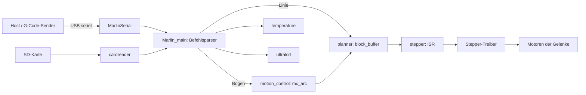
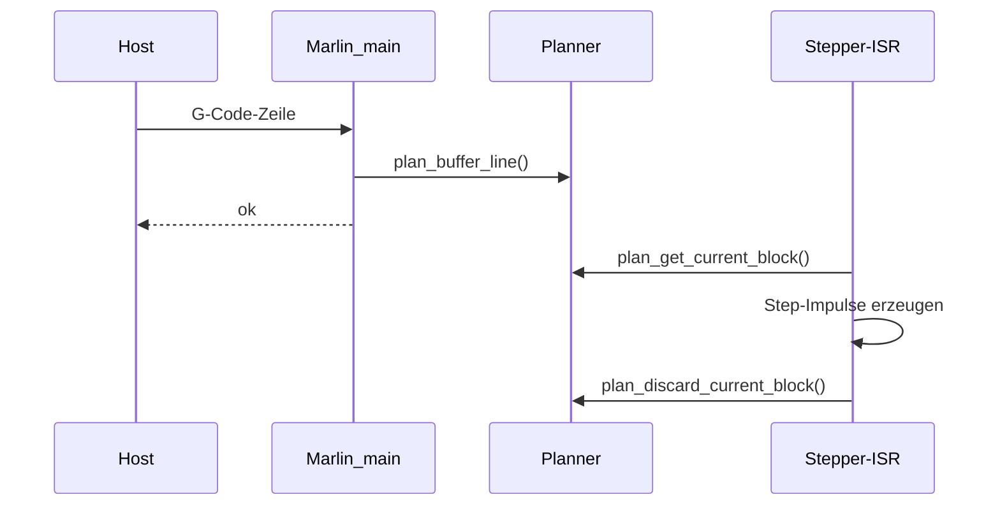

# Architektur

[Zurück zur README](../README.md)

## Überblick

Das Repository ist kein klassisches Softwareprojekt, sondern ein Hardware-Bausatz mit Firmware:

- **Mechanik**: CAD (SolidWorks) und STL je Gelenk (Articulation 1-4, Base, Cover, Electronics box, Machine-tool/Greifer)
- **Firmware**: Marlin 1.0.x (Sprinter/Grbl-Mashup) in C++ für AVR-Boards
- **Dokumente**: BOM und Benutzerhandbuch als PDF

## Komponenten der Firmware

| Modul | Dateien | Aufgabe |
|---|---|---|
| Einstieg / Doku | `Marlin.ino`, `Marlin_BCN3D_Moveo.ino` | Sammelt Includes; die Logik liegt in `.cpp`-Dateien |
| Hauptlogik | `Marlin_main.cpp`, `Marlin.h` | G-/M-Code-Verarbeitung (Annahme anhand der Dateinamen; Inhalt nicht geprüft) |
| Bewegungsplanung | `planner.cpp/.h` | Ringpuffer `block_buffer` mit `block_t`, Beschleunigungsprofile |
| Bogenbewegung | `motion_control.cpp/.h` | `mc_arc()` zerlegt Kreisbögen in Liniensegmente (G2/G3) |
| Schrittmotoren | `stepper.cpp/.h` | Erzeugt Step-Impulse aus Planer-Blöcken, Endstops, Mikroschritte, Digipot |
| Temperatur | `temperature.cpp/.h`, `thermistortables.h` | Heizungsregelung (PID) und Thermistoren |
| Serielle Schnittstelle | `MarlinSerial.cpp/.h` | UART mit Ringpuffer (`RX_BUFFER_SIZE` 128) |
| Konfiguration | `Configuration.h`, `Configuration_adv.h`, `boards.h`, `pins.h` | Compile-Zeit-Optionen und Pinbelegung |
| Persistenz | `ConfigurationStore.cpp/.h` | Einstellungen im EEPROM (M500-Familie, Annahme) |
| SD-Karte | `cardreader.*`, `Sd*.{cpp,h}`, `SdFat*` | Dateizugriff auf FAT-SD-Karte |
| Display/UI | `ultralcd*.{cpp,h}`, `dogm_*`, `LiquidCrystalRus.*`, `language_*.h` | LCD-Menüs, mehrsprachig |
| Sonstiges | `Servo.*`, `watchdog.*`, `BlinkM.*`, `digipot_mcp4451.cpp`, `vector_3.*`, `qr_solve.*` | Servo, Watchdog, LED, Digipot, Bett-Nivellierung |

## Datenfluss

G-Code kommt per USB-Seriell (oder von der SD-Karte) in die Firmware und wird in Planer-Blöcke übersetzt. Der Stepper-Interrupt arbeitet diese Blöcke ab.

## Zuständigkeiten zur Laufzeit

## Hinweise

- Viele Features sind per Präprozessor-Schalter (`#ifdef`) aus- oder eingeschaltet, nicht alle Module sind also in jedem Build aktiv.
- Der Code stammt weitgehend aus Marlin/Grbl/SdFat. Die Lizenzhinweise stehen in den Datei-Headern.
